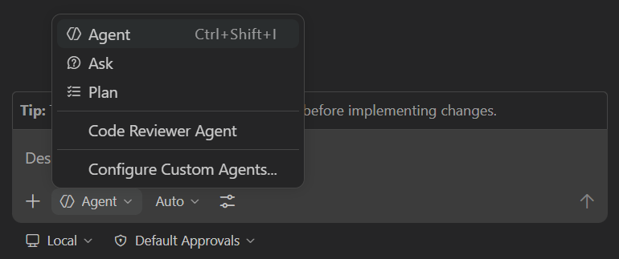

[← Lección anterior: Requisitos previos][previous-lesson] · [Siguiente lección: Modo de agente →][next-lesson]

El contexto es clave al trabajar con IA generativa. Si una tarea debe realizarse de una manera determinada o Copilot necesita conocer información de contexto, debes asegurarte de que pueda acceder a ella. Los [archivos de instrucciones][instruction-files] proporcionan esa orientación sobre la generación de código.

En este ejercicio:

- explorarás cómo llegan a Copilot el contexto específico del proyecto, las directrices de programación y los estándares de documentación mediante las instrucciones personalizadas del repositorio y los archivos de instrucciones asociados a rutas específicas.
- generarás la primera parte de los datos de filtrado (una función auxiliar para editores) con las instrucciones actuales.
- añadirás un estándar general del repositorio a `.github/copilot-instructions.md`.
- repetirás el mismo prompt y observarás cómo el código generado incorpora el nuevo estándar.
- confirmarás los cambios de instrucciones y la parte de filtrado en `main` para que Copilot pueda usar las directrices actualizadas en el siguiente ejercicio.

> [!CAUTION]
> El código generado puede no seguir todos los estándares que hayas definido. Copilot no es determinista. El objetivo del ejercicio es observar la tendencia del cambio de comportamiento después de actualizar las instrucciones, no obtener siempre el mismo código carácter por carácter.

## Archivos de instrucciones

### Escenario

Tailspin Toys tiene directrices y requisitos para las prácticas de desarrollo:

- La capa de datos siempre necesita pruebas unitarias.
- La interfaz de usuario debe usar un tema oscuro y tener un aspecto moderno.
- El código debe incluir documentación TSDoc.
- Al principio de cada archivo debe haber un bloque de comentarios que describa su función.

Usarás archivos de instrucciones para proporcionar a Copilot el contexto necesario y asegurarte de que realiza las tareas de acuerdo con estas prácticas.

### Instrucciones personalizadas

Las instrucciones personalizadas proporcionan a Copilot contexto y preferencias para que pueda comprender mejor tu estilo y tus requisitos de programación. Te permiten orientar sus sugerencias y fragmentos de código. Puedes especificar convenciones, bibliotecas e incluso los comentarios que prefieres. Puedes crear instrucciones para todo el repositorio o para tipos de archivo y tareas concretos.

Hay dos tipos de archivos de instrucciones:

- `.github/copilot-instructions.md`, un único archivo que se envía a Copilot en **cada** solicitud relacionada con el repositorio. Debe contener información general del proyecto pertinente para la mayoría de las solicitudes de chat o CLI, como la pila tecnológica, una descripción general, las prácticas recomendadas y otras indicaciones globales.
- Los archivos `.github/instructions/*.instructions.md`, que permiten crear directrices para tareas o tipos de archivo concretos, como TypeScript, Astro, componentes de interfaz o pruebas unitarias.

> [!NOTE]
> En un IDE, los archivos de instrucciones solo se usan para generar código en Copilot Chat, no para completar código ni sugerir ediciones siguientes.
>
> Copilot Chat, Copilot CLI y el agente de Copilot en la nube usan tanto las instrucciones del repositorio como los archivos `*.instructions.md` con metadatos `applyTo` cuando generan código.
>
> Copilot también [admite otros formatos de instrucciones][custom-instructions-support], como los archivos AGENTS.md y CLAUDE.md.

### Prácticas recomendadas para gestionar archivos de instrucciones

La creación de archivos de instrucciones queda fuera del alcance de este taller. Sin embargo, los ejemplos del proyecto muestran un enfoque representativo. En general:

- Mantén `copilot-instructions.md` centrado en directrices generales del proyecto, como su descripción, estructura y estándares globales de programación.
- Usa `*.instructions.md` para proporcionar directrices específicas para tipos de archivo (pruebas unitarias, componentes Astro, capa de datos) o tareas concretas.
- Escribe en lenguaje natural. Expón las directrices con claridad e incluye ejemplos de cómo debe y no debe ser el código.

No hay una única manera correcta de crear archivos de instrucciones ni de usar IA. La experimentación te ayudará a encontrar el enfoque adecuado para cada proyecto.

> [!TIP]
> Todo proyecto que use GitHub Copilot debería tener una colección completa de archivos de instrucciones. Al explorar los archivos de este proyecto, verás que abarcan muchas tareas, como las [actualizaciones de la interfaz][ui-instructions] y [Astro][astro-instructions].
>
> Copilot también puede ayudarte a generar archivos de instrucciones. Cada interfaz ofrece esta opción de forma distinta; por ejemplo, **Configure Chat → Generate Agent Instructions** en VS Code o `/init` en Copilot CLI. El itinerario de cada interfaz explica cómo hacerlo cuando corresponde.
>
> Si buscas plantillas o un punto de partida, explora [awesome-copilot][awesome-copilot], un repositorio con archivos de instrucciones, agentes personalizados y otros recursos.

[ui-instructions]: https://github.com/github-samples/tailspin-toys/blob/main/.github/instructions/ui.instructions.md
[astro-instructions]: https://github.com/github-samples/tailspin-toys/blob/main/.github/instructions/astro.instructions.md
[awesome-copilot]: https://github.com/github/awesome-copilot
[custom-instructions-support]: https://docs.github.com/copilot/reference/custom-instructions-support

## Explora los archivos de instrucciones personalizadas del proyecto

Dedica un momento a leer los archivos de instrucciones del repositorio: hay un archivo principal `copilot-instructions.md` y varios archivos `*.instructions.md` para distintas tareas. Ábrelos en el editor o en la interfaz web de GitHub.

1. Abre `.github/copilot-instructions.md`.
2. Explora el archivo y fíjate en la breve descripción del proyecto y las secciones **Agent notes**, **Code standards**, **Scripts** y **Repository Structure**. En **Code standards**, fíjate en las directrices anidadas de **GitHub Actions Workflows**. Se aplican a cualquier interacción con Copilot.
3. Abre la carpeta `.github/instructions` y explórala. Hay instrucciones para Astro, la capa de datos de Drizzle, las pruebas y otros ámbitos.
4. Abre `.github/instructions/unit-tests.instructions.md` y fíjate en el campo `applyTo` de la parte superior. Define un patrón glob (relativo a la raíz del repositorio) que determina a qué archivos se aplican las instrucciones. En este caso, coincide con cualquier archivo de prueba TypeScript, por ejemplo, los que cumplen `**/*.test.ts`.
5. Revisa las instrucciones específicas para crear pruebas unitarias en este proyecto.
6. Por último, abre `.github/instructions/drizzle.instructions.md` y desplázate hasta el final. Observa los enlaces a otros archivos de instrucciones, como `unit-tests.instructions.md`, y a archivos existentes del proyecto. Así puedes dividir conjuntos de instrucciones grandes en archivos más pequeños y reutilizables, y señalar ejemplos que Copilot pueda seguir. En este archivo, las rutas son relativas a su propia ubicación, no a la raíz del repositorio.

> [!NOTE]
> La sección **Code formatting requirements** de `copilot-instructions.md` documenta los estándares de programación del proyecto, pero aún no exige documentación dentro del código. En los pasos siguientes añadirás reglas para los comentarios TSDoc y los encabezados de comentario de los archivos.

## Crea una rama para los cambios

Vamos a seguir algunas prácticas recomendadas y crear una rama para los cambios.

1. Vuelve al Codespace del ejercicio anterior.
2. Abre un terminal con <kbd>Control</kbd>+<kbd>\`</kbd> (Mac) o <kbd>Ctrl</kbd>+<kbd>\`</kbd> (Windows/Linux).
3. Crea una rama y cámbiate a ella:

   ```bash
   git checkout -b custom-instructions
   ```

## Usa Copilot Chat antes de actualizar las instrucciones

> [!TIP]
> **Abre Copilot Chat**
>
> Antes de empezar, vuelve al Codespace, abre el panel Copilot Chat y selecciona **New Chat** para iniciar una conversación nueva. El modo y el modelo varían según el ejercicio; cada paso los indica cuando corresponde.

Para observar el efecto de las instrucciones personalizadas, primero envía un prompt mientras está activo el archivo de instrucciones actual. Después lo actualizarás y volverás a enviar el mismo prompt para comparar el resultado.

1. Cierra las pestañas abiertas de ejercicios anteriores para que Copilot solo use el contexto necesario.
2. Abre `src/lib/publishers.ts` para indicar dónde debe ubicarse la función auxiliar.
3. En el menú desplegable de agentes de la vista Chat, selecciona **Agent** para que Copilot pueda aplicar cambios.

   

4. Envía este prompt:

   ```plaintext
   Create or update src/lib/publishers.ts with a data-access helper that returns a list of all publishers with the name and id for each. Apply the file changes.
   ```

5. Copilot explorará el proyecto y aplicará cambios de código, a menudo tanto al archivo auxiliar como a sus pruebas.
6. Observa que la función auxiliar propuesta es una función tipada que recibe un cliente `db` como primer argumento y devuelve una matriz tipada de editores. Esto se debe a las convenciones de la capa de datos de `.github/instructions/drizzle.instructions.md`, que se aplica a `src/lib/*.ts`.
7. Observa que el código propuesto **no incluye** comentarios TSDoc ni un encabezado de comentario a nivel de archivo.

> [!CAUTION]
> Como Copilot es probabilístico, puede que añada comentarios de documentación incluso sin que se lo pidas. No pasa nada; lo importante es observar la mejora de coherencia después de actualizar las instrucciones.

## Añade un estándar del repositorio

Como se ha indicado, `.github/copilot-instructions.md` proporciona información general del proyecto a Copilot. Añadamos los estándares de programación para mejorar las sugerencias.

1. Vuelve a abrir `.github/copilot-instructions.md`.
2. Busca la sección **Code formatting requirements**, que debería estar cerca de la línea 27. Documenta los estándares de programación, pero no exige documentación dentro del código, por eso la función generada no tenía comentarios.
3. Añade estas líneas de Markdown justo después de los estándares existentes:

   ```markdown
   - Every exported function should have a TSDoc comment describing its purpose, parameters, and return value.
   - Before imports or any code, add a comment block to the file that explains its purpose.
   ```

4. Guarda `copilot-instructions.md`.

> [!TIP]
> Como has visto en la lección anterior, las instrucciones pueden guardarse en el nivel del repositorio (`.github/copilot-instructions.md`) para ofrecer directrices globales, o en archivos `*.instructions.md` para lenguajes, tipos de archivo o tareas concretos. El archivo del repositorio es el lugar adecuado para estándares generales como la regla de comentarios que acabas de añadir.

## Repite el prompt y observa el cambio

1. Vuelve a Copilot Chat y selecciona **New Chat** para limpiar el contexto.
2. Vuelve a seleccionar `src/lib/publishers.ts` para que Copilot se centre en el archivo correcto.
3. Envía **el mismo prompt** que antes:

   ```plaintext
   Create or update src/lib/publishers.ts with a data-access helper that returns a list of all publishers with the name and id for each. Apply the file changes.
   ```

4. Observa que el archivo propuesto ahora empieza con un bloque de comentarios parecido a este:

   ```typescript
   /**
    * Asistentes de acceso a datos de editores para la plataforma de financiación
    * colectiva de Tailspin Toys.
    * Proporciona funciones para recuperar información de editores de la base de datos.
    */
   ```

5. Observa que la función propuesta incluye ahora un comentario TSDoc parecido a este:

   ```typescript
   /**
    * Devuelve una lista de todos los editores con su identificador y nombre.
    *
    * @param db - Cliente de base de datos de Drizzle.
    * @returns Una promesa que se resuelve en una matriz de objetos de editor.
    */
   ```

Has orientado a Copilot para que siga un estándar nuevo y lo aplique al código que servirá de base para el siguiente ejercicio.

## Confirma las instrucciones y envía la rama

Los archivos de instrucciones son recursos del repositorio y se gestionan con el mismo sistema de control de versiones que cualquier otro archivo. Vamos a confirmar los cambios y enviar la rama al repositorio.

1. Abre un terminal nuevo con <kbd>Control</kbd>+<kbd>\`</kbd> (Mac) o <kbd>Ctrl</kbd>+<kbd>\`</kbd> (Windows/Linux).
2. Comprueba que están presentes las actualizaciones de instrucciones y de la función auxiliar con:

   ```bash
   git status
   ```

3. Prepara y confirma las instrucciones y todos los archivos modificados por Copilot para la función auxiliar:

   ```bash
   git add .github/copilot-instructions.md src/lib/publishers.ts
   # If git status shows additional supporting updates (for example tests), add those files too.
   git commit -m "Add doc comment standards and publishers helper foundation"
   ```

4. Envía la rama al repositorio:

   ```bash
   git push -u origin custom-instructions
   ```

## Crea y combina una solicitud de incorporación de cambios

Ya has enviado la rama. Ahora abre una solicitud de incorporación de cambios y relaciónala con la incidencia sobre los estándares de documentación del backlog. Copilot puede buscar la incidencia, crear la PR para cerrarla y, después, combinarla.

> [!NOTE]
> En este ejercicio Copilot actuará por primera vez en GitHub. La plantilla del proyecto ya conecta las herramientas de GitHub con tu espacio de trabajo, así que no hay que configurar nada. Es posible que VS Code te pida iniciar sesión en GitHub la primera vez que Copilot use una herramienta. Sigue las instrucciones para autorizarlo. En un ejercicio posterior aprenderás cómo funciona esta conexión (Model Context Protocol).

1. Abre Copilot Chat en tu Codespace.
2. Pulsa <kbd>Control</kbd>+<kbd>Command</kbd>+<kbd>I</kbd> (Mac) o <kbd>Ctrl</kbd>+<kbd>Alt</kbd>+<kbd>I</kbd> (Windows/Linux) para abrir Copilot Chat y confirma que **Agent** está seleccionado.
3. Pide a Copilot que busque la incidencia relacionada con la actualización de los archivos de instrucciones y que cree una PR desde la rama actual. Indícale que describa tanto las actualizaciones de instrucciones como la nueva función auxiliar para editores:

   ```
   Find the issue related to updating the instructions file. Create a new PR from the current branch, highlight that the PR closes that issue, and include that we also added the publishers helper foundation for the upcoming filtering work.
   ```

4. Cuando Copilot te pida permiso para realizar acciones de GitHub, revisa el comando y selecciona **Allow** si corresponde.
5. Cuando se cree la PR, pide a Copilot que la combine y vuelva a `main`:

   ```
   Merge the PR into main. Then return to main locally, and pull the latest code so we are up to date.
   ```

6. Cuando Copilot te pida permiso para realizar acciones de GitHub y ejecutar comandos de shell, revisa el comando y selecciona **Allow** si corresponde.

¡Has creado y combinado una solicitud de incorporación de cambios con ayuda de GitHub Copilot!

## Resumen y pasos siguientes

Has explorado cómo Copilot obtiene el contexto de los archivos de instrucciones del proyecto y has usado Copilot Chat en VS Code para:

- enviar un prompt de generación de código y observar el resultado con las instrucciones *existentes*.
- añadir un estándar general del repositorio a `.github/copilot-instructions.md`.
- repetir el mismo prompt y observar cómo el código propuesto incorpora el nuevo estándar.
- confirmar las instrucciones y la función auxiliar en `main` para que el siguiente ejercicio pueda utilizarlas.

A continuación, aplicarás las instrucciones en el [modo de agente][next-lesson] mientras Copilot añade una funcionalidad al código.

## Recursos

- [Archivos de instrucciones para personalizar GitHub Copilot][instruction-files]
- [Prácticas recomendadas para crear instrucciones personalizadas][instructions-best-practices]
- [Cinco consejos para redactar mejores instrucciones personalizadas para Copilot][copilot-instructions-five-tips]
- [Instrucciones personalizadas personales para GitHub Copilot][personal-instructions]
- [Awesome Copilot: colección de archivos de instrucciones y otros recursos][awesome-copilot]

[previous-lesson]: ../0-prerequisites/
[next-lesson]: ../2-agent-mode/
[instruction-files]: https://code.visualstudio.com/docs/copilot/copilot-customization
[instructions-best-practices]: https://docs.github.com/enterprise-cloud@latest/copilot/using-github-copilot/coding-agent/best-practices-for-using-copilot-to-work-on-tasks#adding-custom-instructions-to-your-repository
[personal-instructions]: https://docs.github.com/copilot/customizing-copilot/adding-personal-custom-instructions-for-github-copilot
[copilot-instructions-five-tips]: https://github.blog/ai-and-ml/github-copilot/5-tips-for-writing-better-custom-instructions-for-copilot/
